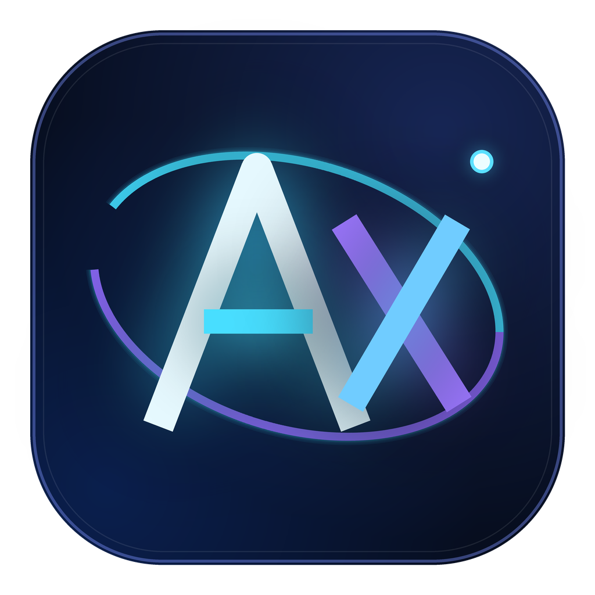
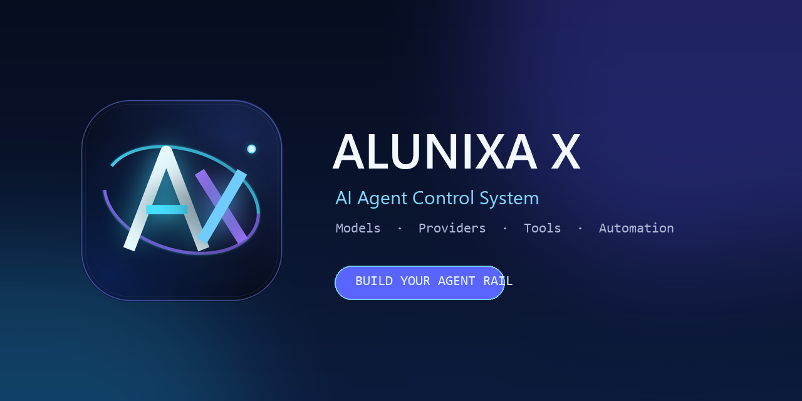
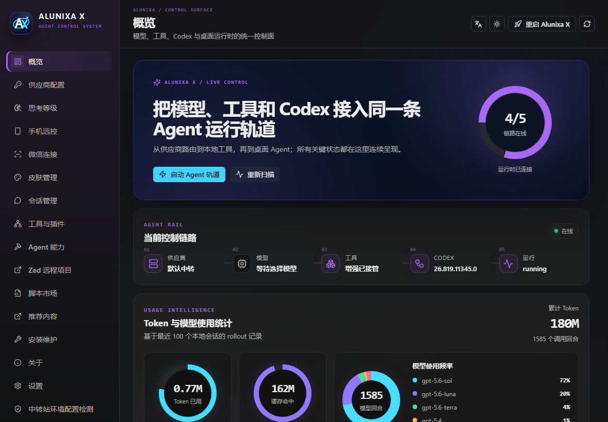

<p align="center">
  
</p>

<h1 align="center">Alunixa X</h1>

<p align="center"><strong>AI Agent Control System</strong></p>

<p align="center">把模型、供应商、工具、自动化、连接与 Codex 桌面运行时接入同一条控制轨道。</p>

<p align="center">
  中文 · <a href="README_EN.md">English</a> · <a href="README_RU.md">Русский</a>
</p>

<p align="center">
  
  
  
  
  
</p>

<p align="center">
  
</p>

## v1.0.38：Codex / Anthropic 协议修复

本地 Responses ↔ Anthropic 桥改用 CC Switch 的独立原生实现，并修复正式 HTTP 服务误接 Chat 转换器的问题；覆盖流收尾、JSON 回退、签名工具续轮、恢复历史、思考参数及缓存写入用量。已用实际 Codex CLI 0.157.1 完成三种隔离链路验证，详见 [v1.0.38 中英俄说明](docs/releases/v1.0.38.md)。

## v1.0.37：完整非广告上游整合

本版另修复跨平台只读原子写保护，补齐 AX 原生应用身份与按架构编译的 macOS 更新测试夹具；v1.0.36 因 macOS 门禁失败未公开发行，v1.0.37 使用新标签完整重建，不降低验证要求。

本轮按最新实现整理 **2026-04-11 至 2026-10-12** 的上游代码，固定版本为 `BigPizzaV3/CodexPlusPlus@e53549ca8c2b2b1edf4199084460af0919f2ded4`（1,456 个近半年提交、656 个上游树文件）；不是只选择 v1.5.0 的几项修复，也不是将旧界面套上新版本号。文件级同步范围和冲突取舍见 [同步报告](docs/reports/2026-10-12-upstream-sync.md)，发行与验证边界见 [v1.0.37 说明](docs/releases/v1.0.37.md)。广告推荐页、供应商推广轮播、远程广告拉取、主题推广链接及推广图片不迁入。

### 这次更新带来什么

- **统一应用**：管理器与启动器现在在同一个 GUI 程序中运行；旧命令入口保留兼容转换，生图 MCP 仍是独立组件。Windows 支持 `AX` 开始菜单搜索；macOS 为一个可见应用包，而不是两个主应用。
- **新版导航**：最左侧为 Agent 与应用级设置，第二列为当前工具的工作区。MCP、Skills、会话、微信、增强、主题、扩展、插件市场与维护各有独立入口；概览只显示实际检查得到的状态，不把进程/端口存在当成模型已请求成功。
- **供应商与模型**：支持官方登录、官方登录混合 API、纯 API、无认证本地服务与聚合路由；共享渠道队列、RPM 限流、错误冷却、会话请求头与自定义请求头统一管理。模型可拖拽排序、改名、导入元数据、设置上下文、压缩百分比、图片处理与 Fast 能力。
- **AX 逐模型协议保留**：普通供应商和存量自定义多模型都可以分别选择 Responses、Chat Completions、Completions、Anthropic Messages、Gemini Generate Content。Claude 的 `xhigh` / `ultra` 实际映射为自适应思维；不能用于该模型/协议的选项明确禁用。
- **对话与运行时**：迁入模块化注入、原生浏览器兼容与恢复、插件索引按需下载、官方用量生命周期、上下文压缩 v2、本地会话索引修复、排队跟进、下一步建议的多协议配置与回答提纲。
- **体验与扩展**：新增本地/远程听写配置、打字特效、Whale 余额组件、缓存分类扫描、CC Switch 导入、Grok/Zed 相关工具接入及独立 Codex 多开。Windows Claude 桌面副本汉化沿用上游实现，官方安装不直接覆盖。
- **AX 原有能力保留**：完整中英俄管理器、生图模型默认项、静态图/GIF/视频背景、包隔离代理检测、启动前配置整理、配置锁/修订校验/备份/回滚与启动失败降级。

### 使用新界面

1. 打开 **Alunixa X**，从最左侧选当前 Agent；在“供应商配置”编辑 Base URL、Key、模型和协议，再保存。
2. 逐模型协议在模型表格中配置；上下文与自动压缩也随模型行保存，排序和改名不会依赖行号错误绑定。
3. MCP 现在是全局独立页，而非供应商详情中的第二份编辑器；禁用写入显式状态，保存失败不会伪装成功。
4. 从概览启动 Codex；独立多开应使用多开入口，每个实例的配置和辅助端口隔离，不与主实例混用。不要以主实例状态代替独立实例的检查结果。
5. 应用级生图模型、缓存、关于、设置在最左栏底部；界面语言选择也在该栏底部，提供 **简体中文 / English / Русский**。

### 安全升级与边界

先退出旧 AX，再运行新安装包；保留现有 `.codex`、供应商和会话目录，不做全量重置。Windows ZIP 需同时保留 `alunixa-x-plus.exe` 与 `alunixa-x-imagegen-mcp.exe`。macOS 的旧双应用安装检测后采用手动迁移入口，不冒险通过旧自更新脚本覆盖两个旧包。

应用隔离代理只在实际 Codex 包上下文中诊断与修改，并备份/回读；关闭的代理不会因地址残留被误判。诊断修复仅针对失效本机代理；另一个“启动前覆盖”策略遵循既有设置，开启后每次将 Codex 包视图的 `ProxyEnable` 写为 0，即使该包代理原本可用；需要合法包代理时应关闭该自动覆盖开关。普通 HKCU、WinHTTP 和机器级代理不修改。初始化失败会显示阶段与恢复入口；目前真实 Windows 首次白屏、真实语音硬件、Claude MSIX、多开及第三方网关全量参数仍需要对应环境验证，不能把静态测试成功理解为所有现场错误已消失。

协议转换保留缓存创建/读取/TTL、工具身份与原生签名；本地工具搜索转成标准 function，并恢复客户端 search item。无执行器的服务端搜索、外国协议不透明状态、损坏或不完整工具历史会明确返回兼容错误，不静默丢数据或制造成功结果。

## Alunixa X 是什么

Alunixa X 是面向桌面 AI Agent 的跨平台控制系统。当前版本重点连接 OpenAI Codex / ChatGPT Desktop，主要通过外部启动器、CDP、本地 helper 与协议代理提供统一管理能力；可选原生浏览器兼容补丁采用受管备份与失败回滚，不以损坏原应用为代价宣称成功。

<p align="center">
  
</p>

它不是简单的模型切换器，也不是一套只会改配置文件的皮肤。Alunixa X 把下面这些链路放进同一个桌面界面：

```text
供应商 → 模型 → 上下文 → MCP / Skills / Plugins → Codex → 桌面运行时
```

## 核心能力

| 控制面 | 能力 |
| --- | --- |
| Agent Rail | 在概览页连续展示供应商、模型、工具、Codex 与本地运行时状态 |
| 供应商网络 | 官方登录、混合 API、纯 API、聚合轮转、单模型路由、Provider Doctor |
| 模型目录 | 每模型上下文窗口、自动压缩 Token 阈值、思考等级、图片处理方式 |
| 全端点代理 | `/v1/**` HTTP、SSE、二进制、multipart、大文件和 Realtime WebSocket |
| 图片工具 | 独立 `image_gen` MCP，多组 API/Key/Model、拖拽设置默认模型，支持生成、编辑、多图、mask 与本地保存 |
| Agent 能力 | 共享终端、会话操作、导出、项目移动、Stepwise、记忆、Goals 与用户脚本 |
| 连接中心 | Remote Control、个人微信连接、Zed Remote 与已有会话恢复 |
| 扩展系统 | MCP、Skills、Plugins、脚本市场和 DreamSkin 主题市场 |
| 运行维护 | 启动注入、失败关闭、Watcher、环境诊断、日志、更新与跨平台安装包 |

## 阅读导航

- [下载与安装](#下载与安装)：平台、安装包和首次启动。
- [界面语言](#界面语言)：简体中文、英语和俄语。
- [从零完成首次配置](#从零完成首次配置)：应用路径、账号、供应商与模型。
- [供应商与协议](#供应商与协议)：模式差异、聚合策略、代理边界。
- [模型与上下文](#模型与上下文)：启动模型、窗口、自动压缩、思考与视觉。
- [配置默认生图模型](#配置默认生图模型)：独立图片 API 与 MCP。
- [动态壁纸](docs/wallpapers.md)：图片、视频、Wallpaper Engine 与配置修复。
- [功能分区详解](#功能分区详解)、[常见问题](#常见问题)、[数据与隐私](#数据与隐私)、[开发](#开发)。

## 下载与安装

从 [GitHub Releases](https://github.com/Alunixa-Code/Alunixa-X/releases/latest) 下载对应平台的正式包：

- Windows：`Alunixa-X-*-windows-x64-setup.exe`
- macOS Intel：`Alunixa-X-*-macos-x64.dmg`
- macOS Apple Silicon：`Alunixa-X-*-macos-arm64.dmg`

| 平台 | 推荐安装包 | 便携/手动分发包 |
| --- | --- | --- |
| Windows x64 | `windows-x64-setup.exe` | `windows-x64.zip` |
| macOS Intel | `macos-x64.dmg` | `macos-x64.zip` |
| macOS Apple Silicon | `macos-arm64.dmg` | `macos-arm64.zip` |

Windows 使用安装向导；macOS 打开 DMG，将一个 Alunixa X 应用拖入“应用程序”。ZIP 用于手动部署，保留 GUI 与 imagegen MCP 两个二进制之间的同级关系。当前正式发布不提供 Linux 安装包。

Alunixa X 不包含 Codex 本体，使用前先安装可运行的 Codex 桌面应用；v1.0.24 已移除原生 Scene/Web，图片、动图和视频均不依赖 Wallpaper Engine。Windows 管理器基于 WebView2，开发构建还需要 Rust/MSVC 和前端工具链。

安装后使用 **Alunixa X / AX** 一个主入口，在管理器内启动 Codex。旧 Launch 快捷入口仍可兼容启动，不再另装第二个主 GUI。macOS 显示名为 **Alunixa X (AX)**，旧双包迁移遵循上面的说明。

## 界面语言

v1.0.23 增加俄语。最左栏底部的语言下拉框可以直接选择 **简体中文 / English / Русский**，无需反复点击轮换。

- 翻译范围包括管理器导航、配置页面、动态壁纸、生图模型、提示框、现有可识别的后端消息、托盘“显示窗口/退出”和本地化日期。
- 选择保存在管理器 WebView 的本地存储中，重新打开仍然有效；首次启动和无效旧值继续默认中文。
- 切换前会确认，因为管理器页面需要重新加载，未保存的编辑会丢失；取消则保持原语言，存储失败不会强行刷新。
- **这不是 Codex 原生界面的俄语语言包**，不会改 `config.toml`；旧强制中文设置不再作为有效运行时能力展示；API 错误原文、用户模型名称、脚本内容和第三方社区内容不作机器翻译。
- [Русское руководство / 完整俄语介绍](README_RU.md) 与 [English guide](README_EN.md) 均包含安装、操作、功能边界和排错说明。

## 从零完成首次配置

1. **打开管理器**：运行 Alunixa X，而不是先打开官方 Codex 快捷方式；在概览中检查应用、启动入口和运行状态。
2. **确认 Codex 路径**：自动检测成功可直接使用；便携版、解压版或多份安装可在设置中选择 `Codex.exe`、`Codex.app` 或应用目录并保存，后续启动复用该路径。
3. **选择接入方式**：官方账号用户使用官方登录；自备 API 用户添加供应商，填写 Base URL、API Key 和服务端真实支持的模型名称，选对上游协议。
4. **配置模型**：拉取或手工填写模型列表，明确选择启动模型；如需自定义上下文窗口、自动压缩、思考等级、图片处理方式或上游协议，在对应模型中设置。
5. **检查总开关并保存**：开启需要的增强功能；需要接管供应商时还要开启供应商配置总开关。开关关闭时只保存配置，不写入 Codex 当前配置。
6. **验证供应商**：先用“测试此模型”或 Provider Doctor 检查配置、模型列表和真实请求，再进入实际对话。
7. **启动 Codex**：点击“启动 Agent 轨道”或使用 Alunixa X Launch。下次启动型配置需要在保存后重新通过此入口启动；不要把“保存成功”理解为已改写当前窗口。

切换供应商可能触发真实配置写入；首次启用需要本地协议代理的功能会显示专门的重启确认。单纯切换管理器语言不会重启 Codex。

## 供应商与协议

### 三种接入模式

| 模式 | 适合谁 | 配置行为 |
| --- | --- | --- |
| 官方登录 | 使用官方 ChatGPT 账号 | 保持官方认证，不额外写入纯 API Key |
| 官方混合 API | 保留官方登录，同时使用自备 API | 保留账号链路，将 API 请求接入所选供应商，需正确填写其地址和 Key |
| 纯 API | 使用第三方或自托管模型服务 | 写入受管 `config.toml` / `auth.json`，通过供应商与模型目录控制请求 |

供应商配置可新增、编辑、拖拽排序、测试、导入 cc-switch，并生成切换前预览。环境检测会检查可能覆盖受管配置的变量、Codex `.env` 和 Clash Verge Rev TUN 状态；删除变量须由用户确认，`CODEX_HOME` 不属于自动清理对象。

### 路由、聚合与协议保真

- **单模型路由**：精确匹配模型名称，使用目标供应商的地址与 Key；目标须为 Responses API，不指向自身或另一个聚合供应商。
- **聚合供应商**：引用已有 API 供应商，不复制其密钥；支持按请求轮转、按对话固定、权重分配和故障转移。策略与成员能力需要配套选择。
- **本地协议代理**：接入 Responses、Chat Completions、旧 Completions、Anthropic 和 Gemini；相同协议的端点转发支持 HTTP/SSE、二进制、multipart 与 Realtime WebSocket 等路径。
- **逐模型协议**：普通自定义配置供应商不再只能使用一个全局协议。模型表格中的“协议”可以为每个模型单独选择 Responses、Chat Completions、Completions、Anthropic Messages 或 Gemini Generate Content；留空时继承供应商默认协议。只要存在协议差异，Codex 配置会指向本地 Responses 代理，代理再按请求模型选择真实上游端点。
- **协议切换边界**：保存后会校验模型名、协议值、URL 和 Key；首次启用逐模型跨协议路由需要重启 Codex。模型重命名、排序、导入和供应商切换会同步协议映射，坏 JSON 不会静默回退成错误传输。
- **不是任意协议的无损万能转换器**：对不能等价表示的工具、签名历史、私有字段或不完整流明确报错，不通过删除内容冒充成功，也不重放结果不明的请求。

完整支持矩阵、回放格式与错误边界见 [协议保真说明](docs/protocol-fidelity.md)。

## 模型与上下文

- **多模型模式从 v1.0.25 起不再把启动模型的窗口写到根 `config.toml`。** `model_context_window` 和 `model_auto_compact_token_limit` 是 Codex 的全局覆盖；旧写法会让后来切换到的模型继续沿用启动模型的值，导致管理器显示与 Codex 内实际窗口不一致。
- 多模型模式由 `model_catalog_json` 逐模型保存并应用上下文窗口与自动压缩阈值；切换模型时 Codex 读取对应目录项。根配置只保留启动模型名称、供应商和目录引用，调整另一模型不会悄悄切换启动模型。
- 普通单模型、纯 API 等非多模型模式仍可使用根级窗口设置。自动压缩阈值必须是正整数且不大于对应窗口，关闭自动压缩时不写入该模型的受管阈值。
- **思考等级**可按供应商、按模型设定上限；它依赖真实上游能力，不会凭空赋予模型不支持的推理档位。
- **图片输入**可保持原图、剔除图片或先由独立 VLM 解析；启用 VLM 时须同时配置其 API、Key 和模型。
- **统计**读取本机任务 rollout 中的 Token 与模型调用记录，不等同于服务商账单，也不是所有云端任务的完整统计。

### 配置默认生图模型

打开左侧 **生图模型**，添加兼容 OpenAI Images 的 **API 地址、API Key、Model**；可保存多组，拖动手柄上下排列，最上方带 **默认** 标记的配置就是 MCP 默认模型，排序自动保存喵~

- API 地址可填基础地址或 `/images/generations`、`/images/edits` 完整地址，生成和编辑请求使用所选配置的同一 API/Key/Model，不改变对话供应商喵~
- 编辑已有配置时 Key 留空保留原值，列表不显示 Key；多个窗口发生修改冲突时要求刷新，不覆盖其他窗口的新配置喵~
- 首次使用保持增强功能开启，并通过 Alunixa X 启动 Codex 加载 MCP；已经加载的新版 MCP 每次调用重新读取配置，后续保存或排序无需重启喵~
- MCP 不显式传 `model` / `profile_id` 时使用首项；清空全部生图配置后恢复原对话供应商及原默认生图模型，不自动重试或轮换到其他生图配置喵~

### 图片、动图和视频背景（请使用 v1.0.24 或更新版本）

**皮肤管理 → 动态壁纸** 支持上传图片、GIF/APNG 和视频，提供预览、透明度、适配、静音与暂停；v1.0.24 修复正式启动器遗漏媒体接口导致的 `Unknown bridge path`，正式启动器与实播测试不再使用不同的分发逻辑喵~

**Wallpaper Engine 原生 Scene/Web 支持已移除**，不再启动额外窗口、捕获桌面或执行项目脚本；离屏实验出现黑屏后已按“稳定优先”的反馈撤下，不继续用可见弹窗换取场景播放喵~

只想用最初的图片背景，直接上传 PNG/JPEG 等图片即可；已实播通过的 GIF/APNG、MP4/WebM 仍可选择使用，俄语界面及其他功能保留喵~

| 壁纸类型 | Windows | macOS | 条件与边界 |
| --- | --- | --- | --- |
| PNG/JPEG/BMP/静态 WebP | 支持 | 支持 | 保持原图与原有适配方式 |
| GIF/APNG/动画 WebP | 支持 | 支持 | 文件本身含动画帧 |
| MP4/M4V/WebM/MOV/OGV | 支持 | 支持 | 最大 2 GiB，实际取决于编码 |
| 旧 Wallpaper Engine Video 设置 | 视频路径兼容 | 视频路径兼容 | 不启动引擎，新设置直接上传视频 |
| 旧 Wallpaper Engine Scene/Web 设置 | 仅预览图片 | 仅预览图片 | 明确标注静态预览，无可用图片时提示重选 |
| Wallpaper Engine Application | 不执行 | 不执行 | 无程序型壁纸支持 |

不再提供项目目录或引擎选择按钮；旧项目只读兼容，不修改原文件，预览路径必须在项目目录内；上传新图片即可替换旧场景喵~

**修复对话配置** 仍可备份并定向修复 `features.guardianv2` 类型错误；保存后在方便时通过完整新版 Alunixa X 重新启动 Codex，不删除任务或重置供应商，完整方法见 [壁纸说明](docs/wallpapers.md) 喵~

## 功能分区详解

| 页面/能力 | 用途 | 使用前提 |
| --- | --- | --- |
| 概览 | 查看供应商→模型→工具→Codex→运行时链路及用量 | 统计来自本地数据，运行状态在启动后更新 |
| 会话管理 | 查看、导出 Markdown、删除、项目迁移、历史归属修复 | 破坏性操作先确认并按功能创建备份；占用文件可能跳过 |
| 图片空间清理 | 外置已被后续压缩点覆盖的旧 Base64 图片，可恢复 | 不处理当前有效恢复上下文；运行中只检查允许范围 |
| 工具与插件 | 独立管理 MCP、Skills、Plugins，供应商切换时合并 | 外部工具仍需其自身依赖和凭据 |
| Agent 能力 | 共享终端、粘贴修复、滚动位置、会话菜单、Fast、Goals | 不同开关可能要求下次启动，具体看界面说明 |
| Stepwise / 记忆 | 独立 API 生成后续建议；本地记忆检索 | Stepwise 需配置 API；记忆支持 embedding 或 BM25 回退 |
| 生图模型 | 为 `image_gen` MCP 配置独立图片服务和默认顺序 | API 必须兼容 OpenAI Images；首次需启动加载 MCP |
| 手机远控 | 账号登录、官方远控状态、配对码、设备撤销 | 依赖官方账号、服务和客户端的可用能力 |
| 微信连接 | 联系人映射独立 Codex 任务，接收执行进度 | 需扫码登录、配置 CLI/工作目录与访问范围 |
| Zed 远程项目 | 管理 SSH 项目和 `ssh://` 打开方式 | 需可用 Zed Remote 与已有 SSH 环境 |
| 皮肤管理 | DreamSkin 本地/社区/ZIP 主题与独立动态壁纸 | 主题包与普通壁纸不是同一套功能 |
| 安装维护/关于 | 快捷方式、Watcher、更新、日志和诊断 | 安装动作需对应系统权限 |

## 更新、备份与回退

### v1.0.35：逐模型协议与 v1.5.0 部分修复

普通自定义配置供应商现在可以为每个模型单独指定协议，支持 Responses、Chat Completions、Completions、Anthropic Messages 和 Gemini Generate Content。留空的模型继承供应商默认协议；保存时协议映射与模型列表一起写入，切换、导入、启动前覆盖和本地代理都会使用同一份映射。首次启用跨协议模型会提示重启，未启用代理的直接 Responses 配置仍保持直连。

本版同步 CodexPlusPlus v1.5.0 的部分非广告修复：配置回读会拒绝被整段 TOML 污染的模型名，避免每次保存进一步转义膨胀；原生 Responses 压缩状态和不透明内容保持透传，不再被转换成普通摘要；GPT-6 Astra、Sol、Luna 加入 Fast 档位识别。广告、赞助入口、推广脚本和推广资源未同步。详见 [发行说明](docs/releases/v1.0.35.md)。

### v1.0.34：Claude 请求兼容与自适应思维

修复 client_metadata 转换报错和 Claude 推理强度丢失；在“模型最高思考等级”增加 Claude 专用“自适应思维”。使用 Chat Completions 或 Anthropic Messages，保存后通过 AX 重启 Codex；本次现场服务器请选择 Chat Completions。固定 xhigh 和自适应已通过真实 AX 转换链路合成请求验证，缓存读写统计保留。详见 [发行说明](docs/releases/v1.0.34.md)。

### v1.0.33：第三方模型 tool_search 兼容修复

修正 Claude、Gemini、GLM、DeepSeek、Grok 等回退模型误继承 GPT 工具搜索能力的问题；保留普通工具和缓存处理。安装后通过 AX 重新启动 Codex 以生成新目录，外部自定义目录不强制覆盖；不代表所有网关支持所有参数。详见 [发行说明](docs/releases/v1.0.33.md)。

### v1.0.32：Codex 26.924 白屏兼容修复

本版修复两条新版宿主兼容路径：DreamSkin 不再把带 `data-app-shell-main-content-top-fade` 状态的整条对话容器隐藏，dispatcher 也可在旧分块名称失效时从已加载应用资源中有界发现。启动前仍会重新应用当前供应商配置、首选模型和 Codex 应用包实际代理视图，不删除会话、密钥或全量重置应用数据喵~

### v1.0.30：上游非广告同步与启动前强制配置

本版同步 CodexPlusPlus v1.2.48 至 v1.4.0 的非广告修复和界面变化，包含聚合路由、自动压缩、代码高亮、原生浏览器状态、DreamSkin 新 selector、模型元数据和多项管理器界面改进；Alunixa X 原有代理、壁纸、俄语、协议保真和白屏恢复逻辑继续保留喵~

每次通过 Alunixa X 启动 Codex 前，管理器都会重新应用当前供应商配置和首选模型；Windows 打包应用代理也会在实际应用包上下文中备份并重新写入 `ProxyEnable=0`，回读成功后才继续启动。备份保留完整原值，不改普通 HKCU 代理、不删除会话、供应商或密钥喵~

广告、赞助商、推广链接、广告脚本和广告资源没有同步喵~


### v1.0.29：白屏后台自动恢复与不闪退

用户现场证明：直接启动当前 Codex 也可能一直白屏；结束它的 `codex.exe` app-server 后会出现原生错误页，再点击 `Try again` 即可进入。v1.0.28 在同类等待超时后还会主动结束整个 `ChatGPT.exe`，因此从 Alunixa X 启动表现为窗口闪退。

v1.0.29 将两类状态分开处理：模型/注入契约失败仍明确失败并回滚；注入已经正确、但原生界面或 app-server 尚未就绪时，不再关闭桌面。启动器会调用 Codex 自己 `Try again` 使用的本地 app-server 重启消息，自动重试一次；仍未恢复则保持窗口、Helper 和桥接运行，并显示 `running_degraded` 与手动重试提示。

- 不终止 `ChatGPT.exe`，不使用全局进程清理，不删除 `auth.json`、`config.toml`、会话、供应商或密钥。
- 主页、设置、登录和侧栏壳层可作为可用原生界面；加载动画、AX 覆盖层和 `Try again` 错误页不会冒充正常状态。
- 该自动恢复只在通过 Alunixa X 启动并完成注入后生效；直接使用 Codex 官方快捷方式仍由官方应用自行处理后台卡住。
- 为避免中断当前已恢复的任务，本版开发验证没有重启用户正在使用的 Codex；安装新版后请完整退出旧 Codex，再从 Alunixa X 启动验证。

### v1.0.28：应用代理与 Agent 能力核对

“Agent 能力 → 运行与配置核对”新增 **应用隔离代理** 检测：分别显示普通进程与 Codex 应用包实际读取的注册表视图。仅当手动代理已启用、没有 PAC、所有端点都是本机地址且连续明确拒绝连接时，才允许“备份并修复”；启动自动修复遵循同一限制，不清空合法代理或仅残留的地址。

- 修复只关闭对应包视图的 `ProxyEnable`，保留地址和例外列表；回读成功后提示是否需重启。恢复备份前会检查包身份和当前修订，避免覆盖之后的新设置。
- 页面分开显示管理器期望、磁盘/CLI 默认与运行验证状态。Fast/Goals 关闭显式写 `false`；未知或不支持的原生能力不会伪装为已启用。
- 保存失败恢复开关；检测到外部修改先重新读取，不能用旧快照继续覆盖。启动和登录后不再拿 AX 的旧能力值重写现有配置；供应商切换保留当前全局 Fast、Goals 和线程数。
- helper 响应、原生界面可见、app-server 和真实模型请求分别标记；“菜单出现”或“端口存在”不等于对话可用。
- 本补丁交付下述已验证的定向修复；完整上游同步与白屏现场验收仍未完成，**不宣称所有问题已解决**。实现、38 项映射、验证边界及回退方法见[排查报告](docs/reports/2026-09-27-startup-capability-repair.md)。

1. 在“关于”检查 GitHub Releases，或手动下载对应平台正式包。更新功能下载并启动安装器，不代表当前 Codex 已加载新功能。
2. 大版本迁移、换机或大量改配置前导出完整配置。**完整备份包含 API Key、登录数据和脚本**；普通界面脱敏不等于备份也脱敏。
3. 需要恢复时使用“导入完整配置”或对应功能的恢复入口，先确认当前任务与应用文件没有被占用。
4. 需要回退程序时从历史 Release 获取对应平台安装包，保留配置备份；不要删除任务数据库来解决界面或壁纸问题。

正式发行由同一不可变标签经 GitHub Actions 构建 Windows x64、macOS x64/arm64，发布六项安装/ZIP 资产。Release 正文列出变更、源码提交、运行来源与 SHA-256；历史标签不用于覆盖新修复。

## 常见问题

**俄语在哪里？为什么 Codex 内还是原来的语言？**

最左栏底部选择 `Русский`。俄语覆盖 Alunixa X 管理器，不替换 Codex 官方语言包；旧强制中文开关已退役，不再写入无效能力。

**保存供应商后重启仍未生效？**

确认供应商配置总开关开启、当前供应商正确、保存成功，并从 Alunixa X Launch 启动。检查环境变量或 `.env` 是否覆盖了 `config.toml`。

**视频预览能播，Codex 背景却没有？**

使用 v1.0.24 或更新版本，确认启用壁纸且透明度不是零，保存后重新经 Alunixa X 启动；检查“关于”的诊断。v1.0.22/v1.0.23 的 `Unknown bridge path` 是正式启动器漏接接口，不是目录选错；管理器预览不是宿主显示成功的证明。

**Wallpaper Engine 目录选了却没有场景？**

v1.0.24 已移除原生 Scene/Web。旧配置有预览图时只显示并明确标记为静态预览，没有可用预览图时请上传图片或视频；不再启动 Wallpaper Engine。

**新任务发送报 `FeatureToml`，旧任务不能恢复？**

若错误明确指向 `features.guardianv2`，使用“修复对话配置”，修复前保留原 TOML 备份，之后重新打开任务。它不修复所有 TOML 语法错误、项目级配置或其他来源。

**生图模型改了但没切换？**

默认是列表首项；显式 `profile_id` 或 `model` 会影响选择。确认首次已通过 Alunixa X 加载 MCP；后续排序和保存不需要重新加载已经运行的新版 MCP。

**怎么提交可用的错误报告？**

附上 Alunixa X/Codex 版本、系统架构、操作步骤、预期/实际行为与脱敏诊断。壁纸问题补充文件类型/编码或项目类型，不提交密钥、完整 `auth.json` 或私有任务内容。

## 从 Codex+++ 迁移

旧 `Alunixa-Code/CodexPlusPlusPlus` 仓库已经归档，最终桥接版本为 `v1.2.67`。现有用户可以在“Codex++ 管理工具 → 关于 → 迁移到 Alunixa X”中自主下载安装 Alunixa X，也可以从 [Codex+++ v1.2.67 最终 Release](https://github.com/Alunixa-Code/CodexPlusPlusPlus/releases/tag/v1.2.67) 直接下载 `Alunixa-X-1.0.6-*` 迁移包。

Codex+++ 与 Alunixa X 继续复用 `~/.codex-session-delete/settings.json`，供应商、模型和增强设置无需手工复制。迁移不会强制卸载旧程序，建议先验证 Alunixa X 正常，再自行卸载 Codex+++。

## 数据与隐私

Alunixa X 默认在本机处理配置、密钥、会话索引和运行日志：

- Codex 配置：`~/.codex/config.toml`
- Codex 登录状态：`~/.codex/auth.json`
- Alunixa X 状态：`~/.codex-session-delete/`
- 生成图片：`$CODEX_HOME/generated_images/`
- Provider 同步备份：`~/.codex/backups_state/provider-sync/`

设置了 `CODEX_HOME` 时，Codex 配置与生成图片使用所选 home；Alunixa X 管理器状态仍使用自己的应用状态目录。上传壁纸位于该状态目录的 `wallpapers/`；guardian 修复备份位于所用 Codex home 的 `alunixa-x-config-repair-backups/`。界面语言单独保存在 WebView 本地存储，不写入供应商配置。

本地处理不代表所有功能离线：模型请求会发往用户配置的上游，更新与在线目录会联网，微信、远控和 WE Web 项目也使用其各自网络环境。

API Key 不应写入 Issue、截图或公开日志。推荐内容、匿名使用统计和 Alunixa 在线目录将在具备清晰开关与隐私说明后接入，不以采集提示词、聊天内容、文件内容或终端输出为前提。

## 开发

技术栈为 Rust edition 2024、Tauri 2、React 19、TypeScript 5 和 Vite 6；正式 CI 使用 Node.js 22。使用仓库锁文件，不必为增加翻译升级第三方依赖。

开发前安装 Node.js/npm、Rust stable，以及 [Tauri 平台前置依赖](https://v2.tauri.app/start/prerequisites/)：Windows 使用 MSVC 构建工具/WebView2，macOS 使用 Xcode Command Line Tools。正式 Windows 打包用 NSIS，macOS 打包在对应平台完成，不使用 WSL。

```powershell
npm --prefix apps/alunixa-x-manager ci
npm --prefix apps/alunixa-x-manager test
npm --prefix apps/alunixa-x-manager run check
npm --prefix apps/alunixa-x-manager run vite:build
node tools/i18n-verify.mjs
node tools/check-local-branding.mjs
cargo fmt --all -- --check
cargo test --workspace --locked --no-fail-fast -- --test-threads=1
cargo check --workspace --all-targets --locked
cargo build --release --locked
```

运行开发管理器：`npm --prefix apps/alunixa-x-manager run dev`。`vite:dev` 只启动前端，真实管理器命令需要 Tauri，浏览器 smoke 则必须提供隔离的 Tauri fixture。

翻译维护入口为 `src/i18n.ts`、`src/i18n-en.ts` 和 `src/i18n-ru.ts`，均位于管理器目录；新增 `t()/tf()` 文案须同时补齐两份词典。`node tools/i18n-verify.mjs` 会检查全部生产 TS/TSX 调用、陈旧/缺失键、参数占位符与后端正则对齐。

已构建前端并准备 Python Playwright/Chromium 后，可运行 `python tools/verify-russian-ui.py` 验证生产页面、持久化切换、深浅主题和长文案布局。它使用内存 Tauri fixture，不修改真实配置或正在运行的 Codex；壁纸的实际 Electron/WE 播放测试另见专项文档。

主要目录如下：

```text
apps/
  alunixa-x-launcher/       后台启动与 image_gen companion
  alunixa-x-manager/        Tauri / React 主控制台
crates/
  alunixa-x-core/           启动、注入、代理、安装与配置核心
  alunixa-x-data/           会话、导出与 Provider Sync
assets/
  brand/                    Alunixa X 品牌资产
  inject/                   Codex renderer 增强脚本
scripts/installer/          Windows NSIS 与 macOS DMG 打包
```

## 项目与反馈

- 项目主页：https://github.com/Alunixa-Code/Alunixa-X
- 问题反馈：https://github.com/Alunixa-Code/Alunixa-X/issues
- 讨论区：https://github.com/Alunixa-Code/Alunixa-X/discussions

如果 Alunixa X 帮到了你，可以支持项目持续维护：

<p align="center">
  
  
</p>

## 开源与兼容性

Alunixa X 以 [GNU Affero General Public License v3.0](LICENSE) 发布，SPDX 标识为 `AGPL-3.0-only`。本项目包含从 CodexPlusPlus 及其贡献历史演进而来的代码，相关原始版权与许可证声明继续保留；Alunixa X 新增与修改部分由 Alunixa-Code 维护。

Alunixa X 是独立第三方项目，不隶属于 OpenAI，也不授予 OpenAI、ChatGPT、Codex 或其他第三方商标和资源的权利。Codex Desktop 更新可能改变页面、CDP 或本地数据契约，届时相关集成功能需要跟随适配。
